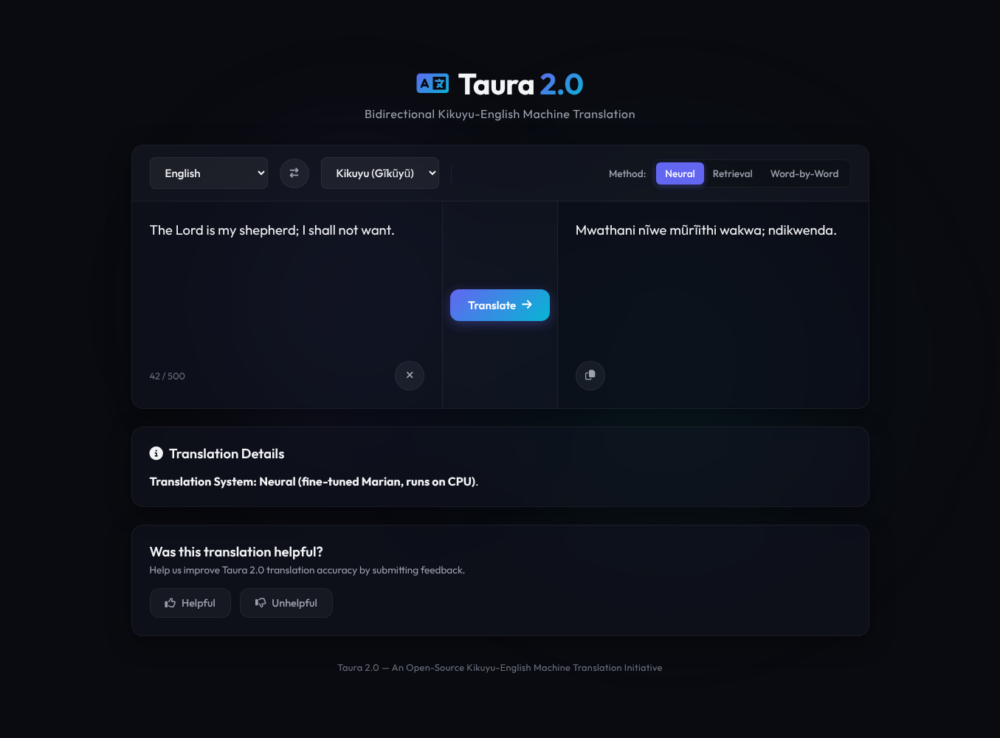

# Taura 2.0

> *"Taũra"* is Kikuyu for *"Translate."*

**Taura** is an open-source machine translation engine for **Kikuyu ↔ English**, one of the first of its kind for this low-resource Bantu language. The Kikuyu are Kenya's largest ethnic group, with 9 to 10 million speakers (roughly 17 to 20% of the population), yet mainstream translation tools largely ignore the language.



## What's Inside

- **Corpus:** Kikuyu-English parallel pairs from all 66 books of the Bible (one CSV each in `data/parallel/`) plus agriculture data (coffee, dairy, poultry, potato, banana, mango, cabbage, avocado). About 35,000 pairs, split 80/10/10 (seed 42) into `data/splits/`.
- **FastText + Procrustes:** monolingual embeddings aligned with iterative Orthogonal Procrustes; serves retrieval and word-by-word translation.
- **Neural (recommended):** fine-tuned Marian models, int8, CPU only, about 78 MB per direction.
- **API and web UI:** FastAPI service (`/translate`, `/translate/candidates`, `/model/info`) with a simple UI at `/`.

## Performance

Latest three evaluated runs on the validation split (`data/splits/val.tsv`). Older runs are in `CHANGELOG.md` and git history.

| Run | Model | Validation | Ki→En BLEU / chrF | En→Ki BLEU / chrF | Size, CPU latency |
|---|---|---|---|---|---|
| 34 | same, trained on all 66 books (adds the last 14 books); single Kaggle run, models not republished. Ki→En down 1.3 BLEU, En→Ki up 3.3 BLEU: within the ~3 BLEU retrain noise | 3,510 val | 35.13 / 50.97 | 38.35 / 57.92 | 4.9 GB total (2 x 2.4 GB) |
| N5 | Marian opus-mt fine-tuned (77M), En→Ki 12 epochs (published neural model; Ki→En N3 scored 39.56 / 56.30) | 3,390 val | - | 26.79 / 54.93 | 78 MB each; 1.51 s En→Ki, 0.59 s Ki→En |
| N6 | Marian opus-mt fine-tuned (77M), both directions on all 66 books (held-out run, train split only; Ki→En 4 epochs, En→Ki 12). Ki→En is +0.7 BLEU on the larger validation set; En→Ki is flat (26.33 vs 26.79, within noise) | 3,510 val | 40.25 / 57.18 | 26.33 / 54.57 | 78 MB each; 1.12 s Ki→En, 2.52 s En→Ki (slower container than N5) |

FastText retrieval returns an existing training sentence, so its BLEU is not directly comparable with the neural rows. Single FastText runs vary by about 3 BLEU between retrains, so differences smaller than that are noise. Published models were refreshed on 2026-11-01: the neural models are the train+val+test pass of run N6 and cover all 66 Bible books plus agriculture data; the N6 row is their quality reference. Neural rows use beam 4 on CPU (CTranslate2 int8, 4 vCPU, one sentence at a time).

## Quick Start

**Requirements:** Python 3.12+, [uv](https://github.com/astral-sh/uv)

```bash
git clone https://github.com/Garnet-Owl/taura-2.0.git
cd taura-2.0
uv sync
```

> **Data & models** are not bundled. Download source files from [Garnet-Owl/taura-datasets](https://huggingface.co/datasets/Garnet-Owl/taura-datasets) on Hugging Face and place them in `data/`. Parallel CSV files are already included in the repo.

### Train from scratch (optional)

Training runs on a GPU provider (Kaggle), not a laptop.

```bash
# 1. Prepare dataset
uv run python -m scripts.prepare_dataset

# 2. Train embeddings + alignment
uv run python -m scripts.train_embeddings

# 3. Serve
uv run uvicorn app.serve.main:app --reload
```

### Run the neural translator (recommended, CPU only)

The fine-tuned Marian models are public on Hugging Face: **[Garnet-Owl/taura-marian-kikuyu-english](https://huggingface.co/Garnet-Owl/taura-marian-kikuyu-english)**. You only need the two int8 folders (about 78 MB each); no GPU and no FastText training are required.

```bash
uv sync
uv run --with huggingface_hub hf download Garnet-Owl/taura-marian-kikuyu-english \
  --include "ki_en/ct2-int8/*" --include "en_ki/ct2-int8/*" --local-dir hf-download
rm -rf models/marian-ct2-int8
mkdir -p models/marian-ct2-int8/ki_en models/marian-ct2-int8/en_ki
cp hf-download/ki_en/ct2-int8/* models/marian-ct2-int8/ki_en/
cp hf-download/en_ki/ct2-int8/* models/marian-ct2-int8/en_ki/
uv run uvicorn app.serve.main:app
```

Repeat `--include` once per folder, and download into a folder inside the project (not `/tmp`), which also works on Windows. A startup warning that the FastText models are not found is expected and harmless: only the `neural` method needs the downloaded models.

Each folder must contain `model.bin` directly (check with `ls models/marian-ct2-int8/en_ki`). Open http://localhost:8000: the web UI uses the **Neural** method by default and falls back to Retrieval when the neural models are not installed. Through the API use `"method": "neural"` (see the API examples below). English to Kikuyu takes about 2 s per sentence on 4 CPU cores; Kikuyu to English about 0.6 s.

Open http://localhost:8000 for the web UI or http://localhost:8000/docs for the API docs.

### Download the FastText models (retrieval and word-by-word)

The trained FastText + Procrustes models are in the `fasttext/` folder of the same public repo, so you do not need to train them. They are large (about 2.4 GB each for `ki.bin` and `en.bin`).

```bash
uv run --with huggingface_hub hf download Garnet-Owl/taura-marian-kikuyu-english \
  --include "fasttext/*" --local-dir hf-download
mkdir -p models/run_hf_fasttext
cp hf-download/fasttext/* models/run_hf_fasttext/
uv run uvicorn app.serve.main:app
```

The server uses the newest `models/run_*` folder, which must contain `ki.bin`, `en.bin`, `proj_ki_en.npy` and `proj_en_ki.npy`. Retrieval also needs `data/splits/train.tsv` (in git) to look up sentences. Retraining is done on a GPU provider (Kaggle) rather than a laptop; Run 22 used `uv run python -m scripts.train_embeddings` on a Kaggle kernel.

## API

```bash
# Translate
curl -X POST http://localhost:8000/translate \
  -H "Content-Type: application/json" \
  -d '{"text": "Mũndũ ũmwe nĩ arakorirũo na thĩna", "source_lang": "ki", "target_lang": "en"}'

# Top-K candidates
curl -X POST http://localhost:8000/translate/candidates \
  -H "Content-Type: application/json" \
  -d '{"text": "the man is reading a book", "source_lang": "en", "target_lang": "ki", "k": 5}'

# Neural translation (needs the Marian models; see 'Run the neural translator' above)
curl -X POST http://localhost:8000/translate \
  -H "Content-Type: application/json" \
  -d '{"text": "The Lord is my shepherd.", "source_lang": "en", "target_lang": "ki", "method": "neural"}'

# Model info
curl http://localhost:8000/model/info
```

## Tests

```bash
uv run pytest
```

## Contributing

Contributions are welcome, especially if you speak Kikuyu, work in low-resource NLP, or want to help expand the corpus. See [AGENTS.md](AGENTS.md) for project standards and [CONTRIBUTING.md](CONTRIBUTING.md) to get started.

## License

MIT. See [LICENSE](LICENSE).
