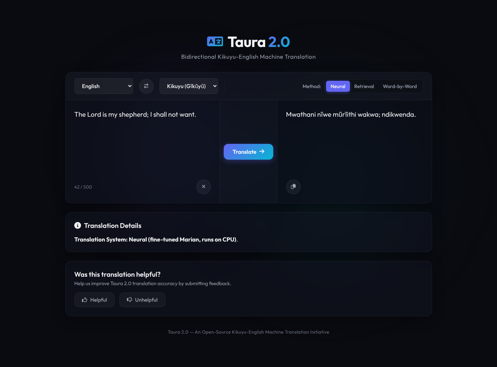

# Taura 2.0: Kikuyu to English translation

> *Taũra* is Kikuyu for "translate."

Taura is a free, open-source machine translation engine for **Kikuyu (Gĩkũyũ) and English**, in both directions. It runs on a normal CPU, no GPU needed.

Kikuyu is spoken by 9 to 10 million people in Kenya, about 17 to 20% of the country, and mainstream translation tools mostly ignore it. I started Taura to change that.



## How good is it?

On my held-out validation set (3,510 sentences), the neural model scores:

- **Kikuyu to English:** 41.3 BLEU, 57.9 chrF
- **English to Kikuyu:** 26.7 BLEU, 54.8 chrF

Each model is about 78 MB (int8) and translates a sentence in roughly 0.6 to 2.4 seconds on 4 CPU cores.

Most of the training text is the Bible plus some agriculture material, so it does best on that kind of language. Everyday speech is harder and I'm still working on it.

## What's inside

- **Corpus:** about 35,000 Kikuyu-English sentence pairs. All 66 books of the Bible, plus agriculture texts on coffee, dairy, poultry, potato, banana, mango, cabbage and avocado. Split 80/10/10 with seed 42.
- **Neural models (recommended):** fine-tuned Marian (opus-mt) models, one per direction, run with CTranslate2.
- **FastText + Procrustes:** monolingual embeddings aligned with Orthogonal Procrustes, used for retrieval and word-by-word translation.
- **API and web UI:** a FastAPI service with a simple page at `/`.

## Try it

You need Python 3.12 or later and [uv](https://github.com/astral-sh/uv).

```bash
git clone https://github.com/Garnet-Owl/taura-2.0.git
cd taura-2.0
uv sync
uv run uvicorn app.serve.main:app
```

Open http://localhost:8000 for the web UI, or http://localhost:8000/docs for the API docs.

The models are public on Hugging Face ([Garnet-Owl/taura-marian-kikuyu-english](https://huggingface.co/Garnet-Owl/taura-marian-kikuyu-english)). The server downloads them on first start and only re-downloads when the Hub has a newer version. If Hugging Face is down, it serves whatever is already on disk.

To fetch the models without starting the server, or to force a fresh download:

```bash
uv run python -m scripts.sync_models [--force]
```

## API

```bash
# Kikuyu to English
curl -X POST http://localhost:8000/translate \
  -H "Content-Type: application/json" \
  -d '{"text": "Mũndũ ũmwe nĩ arakorirũo na thĩna", "source_lang": "ki", "target_lang": "en"}'

# English to Kikuyu with the neural model
curl -X POST http://localhost:8000/translate \
  -H "Content-Type: application/json" \
  -d '{"text": "The Lord is my shepherd.", "source_lang": "en", "target_lang": "ki", "method": "neural"}'

# Top 5 candidates
curl -X POST http://localhost:8000/translate/candidates \
  -H "Content-Type: application/json" \
  -d '{"text": "the man is reading a book", "source_lang": "en", "target_lang": "ki", "k": 5}'

# Model info
curl http://localhost:8000/model/info
```

`method` is `neural`, `retrieval` or `word-by-word`.

## Detailed results

These are the latest three evaluated runs on the validation split. Older runs are in `CHANGELOG.md` and the git history.

| Run | Model | Validation | Ki→En BLEU / chrF | En→Ki BLEU / chrF | Size, CPU latency |
|---|---|---|---|---|---|
| 34 | FastText + Procrustes, trained on all 66 books. Single Kaggle run; published models refreshed with a final train+val+test pass | 3,510 | 35.13 / 50.97 | 38.35 / 57.92 | 4.9 GB total |
| N5 | Marian opus-mt fine-tuned (77M), En→Ki 12 epochs. Ki→En N3 scored 39.56 / 56.30 | 3,390 | - | 26.79 / 54.93 | 78 MB each; 1.51 s En→Ki, 0.59 s Ki→En |
| N6 | Marian opus-mt fine-tuned (77M), both directions retrained on all 66 books. Scores are from the matching held-out run on train only | 3,510 | 41.33 / 57.93 | 26.74 / 54.80 | 78 MB each; 1.02 s Ki→En, 2.39 s En→Ki |

FastText retrieval returns an existing training sentence, so its BLEU can't be compared directly with the neural rows. FastText runs swing by about 3 BLEU between retrains, so smaller differences are noise. Neural rows use beam 4 on CPU (CTranslate2 int8, 4 vCPU, one sentence at a time).

## Train it yourself

Training needs a GPU, so I run it on Kaggle, not on a laptop. The source data is on Hugging Face at [Garnet-Owl/taura-datasets](https://huggingface.co/datasets/Garnet-Owl/taura-datasets); put it in `data/`. The parallel CSV files are already in this repo.

```bash
uv run python -m scripts.prepare_dataset
uv run python -m scripts.train_embeddings
```

## Tests

```bash
uv run pytest
```

## Contributing

Help is welcome, especially if you speak Kikuyu, work on low-resource NLP, or can add to the corpus. Start with [CONTRIBUTING.md](CONTRIBUTING.md). Project standards are in [AGENTS.md](AGENTS.md).

## License

MIT. See [LICENSE](LICENSE).
